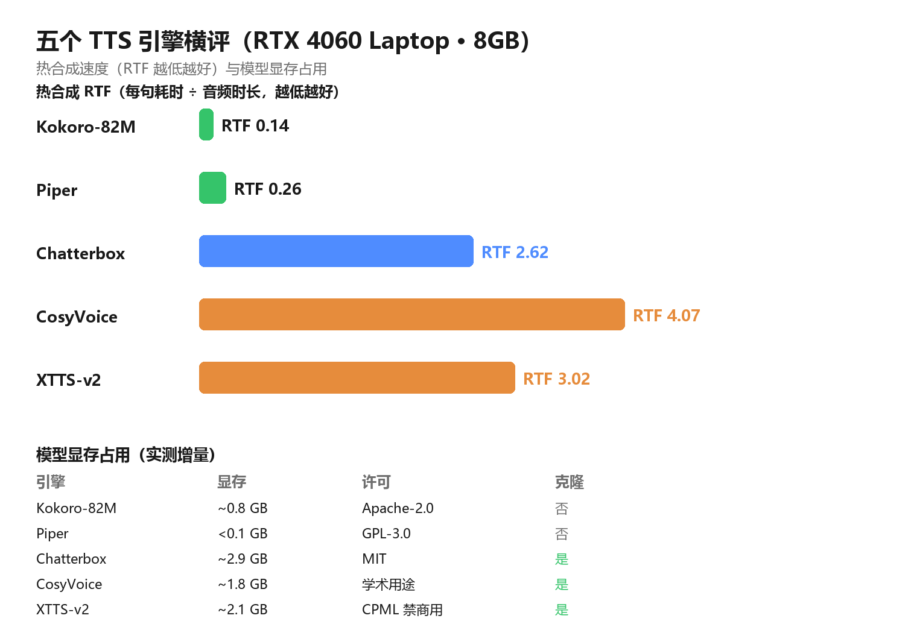
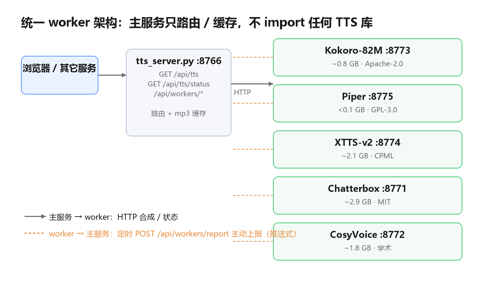

家里的英语学习站要做单词和例句朗读。孩子点一个单词，耳朵里得马上出声音——这件事看起来简单，做起来却处处是坑：在线朗读接口要联网、有额度、还不敢保证隐私；离线引擎一抓一大把，可跑在 8GB 显存的笔记本上，个个都有脾气。

于是把能本地跑的开源 TTS 引擎全试了一遍：**Kokoro、Piper、Chatterbox、CosyVoice、XTTS**。测完发现，这五个东西根本不是「谁更好」的问题——快得离谱的很机械，像真人的慢到没法用，许可有的能商用有的不能。最后定下的方案是：**让五个引擎各自住进独立环境、各起一个常驻 worker，主服务只负责路由和缓存。**

这篇分三部分：先给实测数据和选型结论，再讲统一 worker 架构为什么非要这么设计，最后把这一路踩的坑如实记下来。**数据是实测的，坑是踩过的，没有一处是估出来的。**



*左为热合成速度（RTF 越低越快），右下为显存占用、许可与是否支持声音克隆。Kokoro 在速度、显存、许可三项上全面领先，只是不支持克隆。*

## 一、它解决什么问题

先厘清场景，选型才有意义。这里要的是 **纯英文教育朗读、不需要克隆音色、机器是 8GB 笔记本 GPU**。不是做有声书，不是做播客，更不是要复制某个人说话。

在线接口的问题很直接：断网就哑、每月有免费额度、句子多了要花钱，而且孩子的朗读内容跑到别人服务器上。对一个小网站来说，最省心的其实是「模型装在自己机器上，能离线跑」。

但离线引擎的水很深。同一个「文本转语音」，底下的架构从 82M 参数的小模型到几个 G 的大家伙都有，速度快慢差 **几十倍**，显存占用从不到 0.1GB 到逼近 3GB 不等。买错一个，要么卡得没法用，要么 8GB 显卡直接被吃掉一半。

所以第一步不是写代码，是**把五个候选全测一遍，用数据说话**。

## 二、实测横评

### 2.1 测试方法

- 环境：RTX 4060 Laptop（8GB），Windows，Python 3.11，CUDA 12.4，基线显存 1293MB 来自其它常驻进程。
- 文本：三句英文，含一句《老人与海》的名言 `A man can be destroyed but not defeated.`。
- 每个引擎**独立进程串行跑**，跑完进程退出、显存回收，互不干扰。
- 五个引擎现在都是「模型已加载后」的常驻 worker，测的是**热合成**速度；冷启动（含模型加载）单列一栏。

### 2.2 核心数据

| 引擎 | 模型显存 | 冷启动 | 热合成/句 | RTF | 许可 | 声音克隆 |
| --- | --- | --- | --- | --- | --- | --- |
| **Kokoro-82M** | **~0.8 GB** | 30.6s | **0.70s** | **0.135** | Apache-2.0 | ❌ |
| **Piper** | <0.1 GB | 15.4s | 1.11s | 0.259 | GPL-3.0 | ❌ |
| **Chatterbox-Turbo** | ~2.9 GB | 15.1s* | 10.3s | 2.62 | MIT | ✅ |
| **CosyVoice-300M** | ~1.8 GB | 13.2s* | 20.2s | 4.07 | 学术用途 | ✅ |
| **XTTS-v2** | ~2.1 GB | 111.2s | 14.8s | 3.02 | CPML（禁商用） | ✅ |

\* 常驻 worker 的「冷启动」指模型已加载后的首次请求；真正的模型加载时间：Chatterbox ≈ 45s、CosyVoice ≈ 105s（一次性）。

这里要解释一个词：**RTF（Real-Time Factor）＝ 合成耗时 ÷ 音频时长**。RTF 0.135 的意思是「生成 10 秒语音只用 1.35 秒」，比实时快七倍多；RTF 4 则是「生成 10 秒要等 40 秒」，慢得没法交互。

### 2.3 显存实测（逐个累加）

光看单引擎显存没用，得看**同时常驻几个会不会爆**：

| 状态 | GPU 占用 | 增量 |
| --- | --- | --- |
| 基线（其它进程） | 1293 MB | — |
| + Kokoro | 2082 MB | **+789 MB** |
| + XTTS | 3364 MB | **+2071 MB** |
| + Chatterbox worker | 4176 MB | **+2883 MB** |
| + CosyVoice worker | 5954 MB | **+1778 MB** |

**关键结论**：8GB 卡上，Chatterbox（2.9G）+ CosyVoice（1.8G）同时常驻已占 4.6GB，再加 XTTS（2.1G）就逼近 8025MB —— 基本等于爆。所以不是「能不能同时开」，而是**必须按需启停**。

### 2.4 选型结论

按本场景（纯英文、不克隆、8GB）排下来：

| 排名 | 引擎 | 理由 |
| --- | --- | --- |
| 🥇 1 | **Kokoro-82M** | RTF 0.135 比实时快 7 倍、显存仅 0.8GB、Apache-2.0 可商用，英文朗读质量够用 |
| 🥈 2 | Piper | 最快最轻，但音质机械，适合兜底 |
| 🥉 3 | Chatterbox-Turbo | 音质/表达力最好 + MIT 可商用，但慢（10s/句）、吃 2.9GB |
| 4 | CosyVoice-300M | 中英混合强、支持克隆，但最慢（20s/句）、许可需自行确认 |
| 5 | XTTS-v2 | 音质好但慢、CPML 禁商用、有内存泄漏 |

**最终选择：主用 Kokoro，Piper 兜底。** 需要克隆或更自然的表达时，再按需启动 Chatterbox（MIT，可商用）或 CosyVoice。

一个值得说明的取舍：**XTTS 从「默认」降级了**。它的核心卖点是「17 语言零样本克隆」，可本场景是纯英文、不克隆——这个优势完全用不上；却要付出 RTF 3.02、CPML 禁商用（Coqui 公司 2024 已倒闭，商用授权买不到）、以及社区公认需每 ~50 次重置的内存泄漏。**好钢没用在刀刃上，那就换掉它。**

### 2.5 音质主观听感

数据之外，耳朵也得过关。同一句 `A man can be destroyed but not defeated.` 由各引擎合成（rate 0.9）：

| 引擎 | 一句话听感 |
| --- | --- |
| Kokoro | 清晰自然、语速稳，教育朗读够用；无情绪起伏 |
| Piper | 机械感明显，元音偏平，但清晰度够 |
| XTTS | 音色自然、连贯性好；默认 Brenda 的 J 发音更准 |
| Chatterbox | 表达力最强，语调起伏自然，接近真人；英文母语感最好 |
| CosyVoice | 中英混合强，纯英文也自然，但语速偏慢 |

对「孩子跟读单词」这个用途，Kokoro 的清晰稳定恰好够了——不追求表演力，追求每个音都咬准。

### 2.6 亲耳听：同一句话，五个引擎

光看文字不如自己点。下面五段是同一句话 `A man can be destroyed but not defeated.`（rate 0.9）由各引擎合成的原始输出，点播放即可直接对比——注意音色、语速和自然的起伏差别，这就是上表「听感」的来源。

<figure style="margin:1em 0;">
<audio controls preload="none" style="width:100%;max-width:520px;display:block;margin:.3em 0;"><source src="/images/2026.11.05/sample-kokoro.mp3" type="audio/mpeg">你的浏览器不支持音频播放。</audio>
<figcaption style="font-size:.9em;color:#666;">Kokoro-82M · af_heart（美音女声）——RTF 0.135，最清晰省显存</figcaption>
</figure>

<figure style="margin:1em 0;">
<audio controls preload="none" style="width:100%;max-width:520px;display:block;margin:.3em 0;"><source src="/images/2026.11.05/sample-piper.mp3" type="audio/mpeg">你的浏览器不支持音频播放。</audio>
<figcaption style="font-size:.9em;color:#666;">Piper · en_US-lessac-medium——最快最轻，但机械感明显</figcaption>
</figure>

<figure style="margin:1em 0;">
<audio controls preload="none" style="width:100%;max-width:520px;display:block;margin:.3em 0;"><source src="/images/2026.11.05/sample-xtts.mp3" type="audio/mpeg">你的浏览器不支持音频播放。</audio>
<figcaption style="font-size:.9em;color:#666;">XTTS-v2 · Ana Florence——音色自然，但 RTF 3.02、禁商用</figcaption>
</figure>

<figure style="margin:1em 0;">
<audio controls preload="none" style="width:100%;max-width:520px;display:block;margin:.3em 0;"><source src="/images/2026.11.05/sample-chatterbox.mp3" type="audio/mpeg">你的浏览器不支持音频播放。</audio>
<figcaption style="font-size:.9em;color:#666;">Chatterbox-Turbo——表达力最强、接近真人，但慢且吃 2.9GB</figcaption>
</figure>

<figure style="margin:1em 0;">
<audio controls preload="none" style="width:100%;max-width:520px;display:block;margin:.3em 0;"><source src="/images/2026.11.05/sample-cosyvoice.mp3" type="audio/mpeg">你的浏览器不支持音频播放。</audio>
<figcaption style="font-size:.9em;color:#666;">CosyVoice-300M · 英文女——自然但语速偏慢，RTF 4.07</figcaption>
</figure>

> 五段音频均为本地引擎真实合成的原始输出（未做任何后期处理），与 `samples/` 目录下的 WAV 一致，这里转成 mp3 只是为了让网页加载更快。

## 三、架构：为什么五个引擎各住一间屋

选完引擎只是开始。真正的麻烦在于：**这五个引擎的依赖互相打架，装不进同一个 Python 环境**。

XTTS 要 `transformers<4.40`，Chatterbox 要 `transformers==5.2`——这两个版本直接冲突，装在一起就有一个起不来；Kokoro 要 spacy + misaki 一整套，Piper 却只要 onnxruntime。硬凑一个环境，结局是全员陪葬。

于是架构定成这样：**主服务不 import 任何 TTS 库，只做路由和缓存；每个引擎在自己的 venv 里起一个常驻 HTTP worker。**

```
                     ┌──────────────────────────────┐
  浏览器 / 其它服务 ─▶│  tts_server.py  :8766        │
                     │  /api/tts  /api/tts/status   │
                     │  /api/workers/*              │
                     └───┬──────┬──────┬──────┬─────┘
                         │ HTTP │      │      │
              ┌──────────┘      │      │      └────────────┐
        :8773 kokoro      :8775 piper  :8774 xtts   :8771 chatterbox
        (.venv_kokoro)   (.venv_piper) (.venv_xtts) (.venv_chatterbox)
                                              :8772 cosyvoice (.venv_cosyvoice)
```



*主服务（灰）与五个常驻 worker（绿）各自独立；实线是主服务调用 worker 合成，橙虚线是 worker 定时主动上报自身状态。*

这套架构带来三个直接好处：

- **依赖互不污染**：每个 engine 一个 venv，`transformers` 爱哪个版本装哪个版本。
- **主服务秒起**：`tts_server.py` 零第三方依赖（只用标准库 + 可选 ffmpeg），启动 1 秒；某个引擎崩了，其它照常。
- **模型只加载一次**：worker 常驻内存，而不是每次请求都起一次性子进程。

最后这条尤其关键。Chatterbox 加载要约 45s、CosyVoice 约 105s、XTTS 约 111s——如果每次合成都重新加载模型，用户点一个单词要等两分钟，根本不可用。**所以「常驻 worker」不是优化，是能不能用的底线。**

每个 worker 对外只暴露两个接口，主服务靠它对接：

```text
GET /status                                        → {ok, ready, loading, error, device, sr, spks}
GET /synth?text=..&rate=..&voice=..&out=<绝对路径>   → 合成到 out，返回 {ok, path, ms}
```

worker 内部再用一把锁把合成**串行化**——8GB 卡并发合成就是抢显存，串行反而稳。

## 四、部署与使用

### 4.1 环境要求

| 项目 | 要求 |
| --- | --- |
| 系统 | Windows 10/11 x64（实测环境） |
| 显卡 | NVIDIA 显卡，8GB 显存可跑 Kokoro；要常驻多个大引擎建议 12GB+ |
| Python | 3.11（每个引擎一个独立 venv） |
| 磁盘 | 五个引擎模型合计约 8GB（XTTS 约 2G、Chatterbox 约 2.9G、CosyVoice 约 2.2G 等） |
| 依赖 | 主服务零第三方依赖；各 worker 依赖见 `requirements.txt` |

### 4.2 目录结构

```text
TTS_service\
├─ tts_server.py          主服务（路由 / 缓存 / 有道，不 import TTS 库）
├─ run_all.py             按 config.json 启动 worker + 主服务
├─ config.json            默认起哪些引擎（默认只起 kokoro）
├─ web\index.html         前端控制台
├─ engines\
│   ├─ worker_base.py     通用 worker 框架（HTTP + 状态 + 串行锁 + 主动上报）
│   ├─ registry.py        引擎注册表 + worker 进程管理
│   └─ *_server.py        各引擎 worker（:8771 - :8775）
├─ .venv_kokoro\ .venv_piper\ .venv_xtts\
├─ .venv_chatterbox\ .venv_cosyvoice\    ← 5 个独立 uv 环境
├─ models\                所有引擎模型统一放这里（不塞进 venv）
├─ audio\tts\             mp3 缓存
└─ samples\               各引擎试听样本
```

**模型放 `models\<engine>\` 而不是塞进 venv**，是一条踩过的经验：venv 是可重建的依赖环境（`uv venv --clear` 会清空），模型是数据，混进去极危险。

### 4.3 启动

```bat
py -3 run_all.py --only kokoro   :: 只起 kokoro（推荐日常，~0.8GB 显存）
py -3 run_all.py --all           :: 起全部 5 个（约 7.5GB 显存，8GB 卡会很紧）
py -3 tts_server.py              :: 只起主服务，worker 从网页里单独启停
```

Windows 下双击 `启动TTS服务.bat` 就是交互式启动，按 `config.json` 决定默认起哪些引擎。**关掉那个命令行窗口 = 停止服务。**

### 4.4 调用

主服务暴露统一的 HTTP 接口，任何本地服务都能直接调：

| 接口 | 说明 |
| --- | --- |
| `GET /api/tts?q=&engine=&voice=&rate=&kind=word\|eg` | 返回音频字节 |
| `GET /api/tts/status` | 各引擎状态 + 音色 |
| `GET/POST /api/workers/start?engine=xxx` | 启动某引擎 worker |
| `GET/POST /api/workers/stop?engine=xxx` | 停止某引擎 worker |

前端一行就能试听：

```js
fetch('http://127.0.0.1:8766/api/tts?q=hello+world&engine=kokoro&kind=eg&rate=0.9')
  .then(r => r.blob()).then(b => new Audio(URL.createObjectURL(b)).play());
```

合成结果落盘成 mp3 缓存，按引擎分目录存（`audio/tts/engines/<engine>/`），换引擎不会串音色；同一句话第二次请求直接命中缓存，毫秒返回。

### 4.5 复现测速

```bash
# 1. 启动全部 worker（各自独立 venv，模型只加载一次）
py -3 run_all.py --no-main

# 2. 串行对比（每个引擎独立进程，跑完释放显存）
py -3 bench_serial.py --engines kokoro,piper,xtts,chatterbox,cosyvoice --out bench_all.json
```

## 五、踩过的坑

这部分不好看，但最值钱。都是真踩出来的。

### 5.1 控制台刷新慢到 4 秒

前端控制台打开一次，接口要 4 秒多。第一反应是前端慢，实际是**主服务在逐个探测 5 个 worker**：`/api/tts/status` 和 `/health` 都会挨个去连每个 worker 的端口。而 Windows 上连接一个**没启动**的本地端口不会立刻拒绝，要等约 2 秒超时——4 个没起的引擎串行探完就是好几秒。

改法分两步：先并发探测 + TCP 快速预检（降到约 0.5s）；但根治是换思路——**不再由主服务去「问」，而是让 worker 主动「报」**。

worker 每隔 3 秒把自身状态 POST 给主服务 `/api/workers/report`，主服务存进内存快照；控制台打开时**只读快照、零探测**，之后每 3 秒读一次快照做局部刷新。改完 `/api/tts/status` 从 4200ms 降到 **7ms**，`/api/workers/status` 到 **1ms**。

顺带发现 `nvidia-smi` 每次查 GPU 要 ~100ms，而 GPU 不会热插拔——缓存 60 秒，又省一笔。

### 5.2 停止按钮永远是灰的

控制台里 Kokoro 明明在跑，停止按钮却点不动。查下来：停止按钮只在 `managed == true` 时可点，而 `managed` 只表示「由网页启停接口启动的进程」。kokoro 是 `run_all.py` 在命令行起的，主服务手里没有它的进程句柄，`managed=false`，所以按钮灰了。

改法：非托管的 worker，通过 `netstat` 找到监听该端口的 PID，**先校验命令行里确实是本项目的这个引擎 worker**（防误杀），再用 `taskkill` 终止；同时把前端按钮的启用条件从「托管的」改成「运行中的」。现在能启动就能停止，端口上是别的程序则拒绝并提示。

### 5.3 torch 2.6 的 `weights_only` 变了

torch 2.6 把 `torch.load` 的 `weights_only` 默认值改了，XTTS 加载直接报 `UnpicklingError`。解决办法是在加载处包一层强制 `weights_only=False`。

### 5.4 `pkg_resources` 缺失

Chatterbox 的水印模块 `perth` 依赖 `pkg_resources`，而新版 setuptools（>=81）已经移除它。每个 venv 都得单独装 `setuptools==80.9.0`。uv 创建的 venv 默认还不带 setuptools，也得补。

### 5.5 中文 Windows 控制台是 GBK

worker 里一旦 `print` 中文日志，在 GBK 控制台就崩。入口处统一 `sys.stdout.reconfigure(encoding="utf-8", errors="replace")`，一个都不能漏。

## 六、已知限制

| 限制 | 说明 |
| --- | --- |
| 显存 | 8GB 卡不能全开五个引擎，必须按需启停 |
| 平台 | 主要在 Windows 验证，`taskkill`/`netstat`/`.bat` 都依赖 Windows |
| Kokoro 音色 | 只有少数固定音色，不能克隆 |
| Kokoro 情感 | 朗读平稳，无情绪起伏，做教学够用、做表演不够 |
| XTTS 许可 | CPML 禁商用，且已无官方商用渠道 |
| CosyVoice 许可 | 「学术用途」，商用需自行确认 |
| 首次加载 | 大引擎首次加载 45–111s，需要等待 |
| 缓存 | mp3 缓存按文本 hash，改语速/换音色会另存一份 |

## 七、它是怎么被写出来的（简）

整件事是在对话里由 AI 逐步搭起来的，人负责定方向和验收，AI 负责查证、写代码、改错。有三点值得记：

**选型不是拍脑袋，是先测。** 一开始默认想用 XTTS（名气大、能克隆），是实测数据把它推翻的：RTF 3.02、禁商用、内存泄漏，而对纯英文朗读这个场景，它的核心优势全部用不上。

**架构的每一次调整都是被问题逼出来的。** 主服务 import TTS 库导致环境和引擎冲突 → 拆成独立 worker；一次性子进程每次重载 100 秒 → 改成常驻；逐个探测太慢 → 改成 worker 主动上报。没有一条是一开始就想到的。

**结论不是一次说对的。** 「刷新慢是前端问题」被排除了，「停止按钮是 UI bug」其实是进程归属问题——都是被日志和实测纠正出来的。

一句话：**AI 负责查证与试错，人负责定目标和验收；数字不是估的，是跑出来的。**

## 八、开源依赖

| 引擎 / 工具 | 用途 | 许可 |
| --- | --- | --- |
| [Kokoro-82M](https://huggingface.co/hexgrad/Kokoro-82M) | 主力英文朗读 | Apache-2.0 |
| [Piper](https://github.com/rhasspy/piper) | 轻量兜底 | GPL-3.0 |
| [Chatterbox](https://github.com/resemble-ai/chatterbox) | 高表达力 + 克隆 | MIT |
| [CosyVoice](https://github.com/FunAudioLLM/CosyVoice) | 中英混合 + 克隆 | 学术用途 |
| [Coqui XTTS-v2](https://huggingface.co/coqui/XTTS-v2) | 多语言克隆 | CPML（禁商用） |

主服务 `tts_server.py` 本身只用 Python 标准库（加可选 ffmpeg 转 mp3），没有第三方 Python 包；重活都在各 worker 的独立环境里。

---

*本文所有速度、显存、耗时均来自本机 RTX 4060 Laptop（8GB）实测，测试文本与方法见第二节。量级仅供同类硬件参考，不同机器结果会有出入。*
